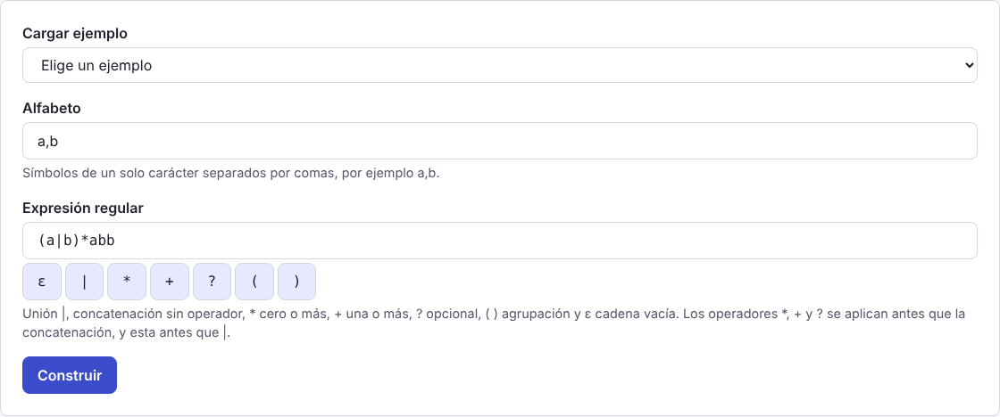
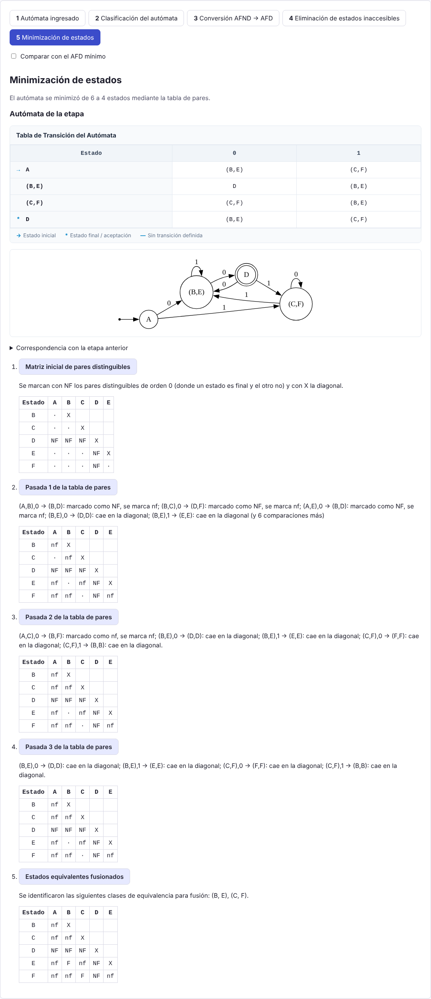
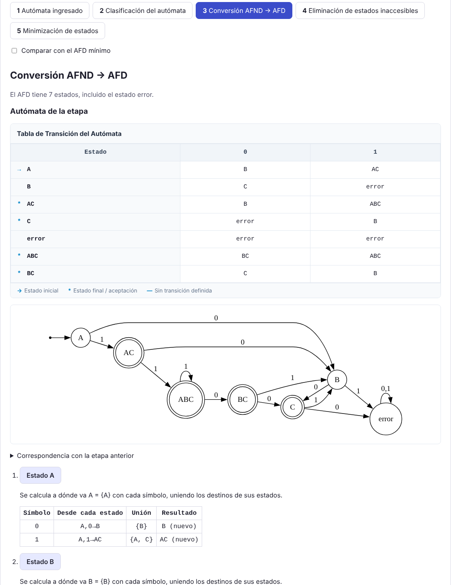
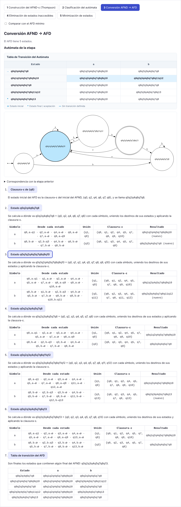
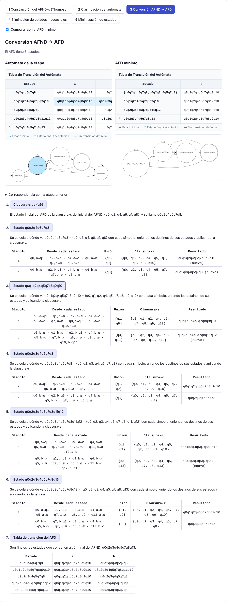
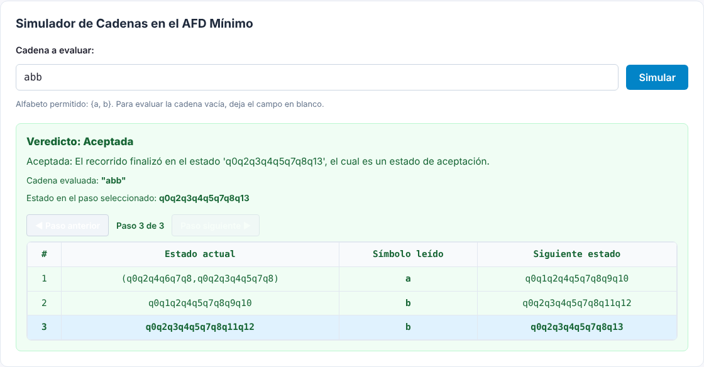

# Manual de usuario

**Software educativo para la construcción, determinización y minimización de autómatas finitos**

**Materia:** Teoría de la Computación
**Proyecto:** Microproyecto #3
**Autores:** David Santiago Rincón Bautista y Ángel Jhoan Díaz Vargas

---

## Contenido

1. Cómo abrir la aplicación
2. Modalidad A: a partir de un lenguaje
3. Modalidad B: a partir de un autómata
4. Cómo leer los resultados
5. Simulador de cadenas

---

## 1. Cómo abrir la aplicación

La aplicación corre en el navegador. Con Node.js 22 instalado, se descarga el proyecto, se instalan las dependencias con `npm install` y se inicia con `npm run dev`; después se abre `http://localhost:5173`. El archivo `README.md` del proyecto detalla estos pasos.

En la parte superior hay dos pestañas, una por modalidad: **«Modalidad A: lenguaje»**, que aparece al iniciar, y **«Modalidad B: autómata»**. En ambas, al procesar la entrada aparecen cinco pestañas de etapas (sección 4) y, al final de la página, el simulador de cadenas (sección 5).

---

## 2. Modalidad A: a partir de un lenguaje

### 2.1 Qué hace

La Modalidad A construye el AFD mínimo de un lenguaje regular descrito con un alfabeto y una expresión regular. La aplicación arma primero un AFND-ε con la construcción de Thompson, lo clasifica, lo convierte en AFD, elimina los estados inaccesibles y lo minimiza, y explica cada etapa paso a paso.

### 2.2 Cómo usarla

1. Elige la pestaña **«Modalidad A: lenguaje»**.
2. Escribe el **alfabeto**: símbolos de un solo carácter separados por comas, por ejemplo `a,b` o `0,1,2`.
3. Escribe la **expresión regular** con la sintaxis de la sección 2.3. Los botones bajo el campo insertan `ε` y los operadores donde está el cursor, lo que sirve porque `ε` no está en el teclado.
4. Pulsa **«Construir»**.

En lugar de los pasos 2 y 3 puedes elegir un ejemplo en **«Cargar ejemplo»**, que llena ambos campos.



### 2.3 Sintaxis de la expresión regular

| Escribe                  | Significa          | Ejemplo   | Cadenas que describe |
| ------------------------ | ------------------ | --------- | -------------------- |
| dos expresiones seguidas | concatenación      | `ab`      | `ab`                 |
| `\|`                     | unión (una u otra) | `a\|b`    | `a`, `b`             |
| `*`                      | cero o más veces   | `a*`      | ε, `a`, `aa`…        |
| `+`                      | una o más veces    | `a+`      | `a`, `aa`…           |
| `?`                      | cero o una vez     | `a?`      | ε, `a`               |
| `( )`                    | agrupar            | `(ab)*`   | ε, `ab`, `abab`…     |
| `ε`                      | cadena vacía       | `a(b\|ε)` | `a`, `ab`            |

Los operadores `*`, `+` y `?` se aplican primero, después la concatenación y al final la unión: `ab*|c` significa «`a` seguida de cero o más `b`, o bien `c`». Si quieres otro orden, usa paréntesis. Los espacios no importan y la expresión puede tener hasta 200 caracteres.

| Lenguaje                                                          | Alfabeto | Expresión    |
| ----------------------------------------------------------------- | -------- | ------------ |
| Cadenas que terminan en `abb`                                     | `a,b`    | `(a\|b)*abb` |
| Palabras que inician y terminan en `a`, con `e` o `i` en medio    | `a,e,i`  | `a(e\|i)*a`  |
| Palabras que inician y terminan en `0`, con unos y doses en medio | `0,1,2`  | `0(1\|2)*0`  |

### 2.4 Ejemplo completo: `(a|b)*abb`

Con el alfabeto `a,b` y la expresión `(a|b)*abb`, la construcción de Thompson genera un AFND-ε de 14 estados (inicial `q6`, final `q13`). La clasificación lo identifica como no determinista por sus transiciones ε, la conversión produce un AFD de 5 estados, ninguno es inaccesible y la minimización fusiona dos de ellos, de modo que el AFD mínimo tiene 4 estados. El simulador acepta `abb` y `aabb` y rechaza `ab` y la cadena vacía.

### 2.5 Errores comunes

Cada error aparece debajo del campo que hay que corregir y, si se refiere a un carácter, lo señala resaltado.

| Mensaje                                                            | Cómo corregirlo                                                                               |
| ------------------------------------------------------------------ | --------------------------------------------------------------------------------------------- |
| El alfabeto está vacío.                                            | Escribe al menos un símbolo, por ejemplo `a,b`.                                               |
| El símbolo "a" está repetido en el alfabeto.                       | Deja cada símbolo una sola vez.                                                               |
| "\*" es un símbolo reservado y no puede formar parte del alfabeto. | Usa otro carácter; `ε`, `\|`, `*`, `+`, `?`, `(`, `)`, la coma y el espacio están reservados. |
| Cada símbolo debe tener un solo carácter, y "ab" tiene 2.          | Separa los símbolos con comas: `a,b`.                                                         |
| "c" (posición 3) no pertenece al alfabeto {a, b}.                  | Agrega el símbolo al alfabeto o quítalo de la expresión.                                      |
| Falta cerrar el paréntesis abierto en la posición 1.               | Agrega el `)` que falta.                                                                      |
| "\*" no tiene una expresión a la que aplicarse.                    | Pon el operador después de un símbolo o de un paréntesis, como en `a*`.                       |
| La expresión tiene 201 caracteres y el máximo es 200.              | Acorta la expresión.                                                                          |
| La conversión generaría más de 200 estados.                        | Simplifica la expresión; algunas, como $(a\|b)^*a(a\|b)^7$, generan demasiados subconjuntos.  |

---

## 3. Modalidad B: a partir de un autómata

### 3.1 Qué hace

La Modalidad B recibe un autómata finito, determinista o no determinista, definido por sus estados, su alfabeto, su estado inicial, sus estados finales y sus transiciones. La aplicación lo clasifica, lo convierte en AFD si hace falta (si ya es determinista lo indica y continúa), elimina los estados inaccesibles y lo minimiza.

### 3.2 Cómo usarla

1. Elige la pestaña **«Modalidad B: autómata»**.
2. En **«Conjunto de Estados (Q)»**, escribe los nombres de los estados separados por comas, por ejemplo `A, B, C, D` o `q0, q1, q2`. Los nombres solo pueden tener letras, dígitos y guion bajo, y no se puede usar `error`, porque está reservado para el estado sumidero que crea la aplicación.
3. En **«Alfabeto de Entrada (Σ)»**, escribe los símbolos separados por comas, por ejemplo `0, 1`. Siguen las mismas reglas de la Modalidad A: un carácter por símbolo y sin caracteres reservados.
4. Elige el **estado inicial** en la lista desplegable y marca las casillas de los **estados finales**.
5. Completa la **cuadrícula de transiciones**, que tiene una fila por estado y una columna por símbolo, más la columna `ε`. En cada celda escribe el estado destino; para un autómata no determinista, escribe varios destinos separados por comas (`A, C`). Deja la celda vacía si no hay transición.
6. Pulsa **«Procesar Autómata»**.

En lugar de llenar el formulario puedes elegir uno de los ejemplos de clase en **«Cargar ejemplo de clase predefinido»**, que completa todos los campos.

### 3.3 Modo JSON

El enlace **«Modo avanzado: Pegar autómata en JSON»** cambia el formulario por un campo de texto donde se puede pegar el autómata completo con este formato:

```json
{
  "states": ["A", "B", "C"],
  "alphabet": ["0", "1"],
  "initial": "A",
  "finals": ["C"],
  "transitions": [
    ["A", "0", "B"],
    ["A", "1", "A"],
    ["A", "1", "C"],
    ["B", "0", "C"],
    ["C", "1", "B"]
  ]
}
```

Cada transición es `[origen, símbolo, destino]`; un autómata no determinista repite el origen y el símbolo con varios destinos, y una transición vacía usa `ε` como símbolo. El enlace **«Cambiar a formulario visual con cuadrícula»** vuelve al formulario normal.

### 3.4 Ejemplo 1: AFD de clase con seis estados

El ejercicio de minimización de clase tiene los estados A a F, inicial A y único final D:

| Q   | 0   | 1   |
| --- | --- | --- |
| →A  | B   | C   |
| B   | D   | E   |
| C   | F   | B   |
| \*D | E   | C   |
| E   | D   | E   |
| F   | F   | B   |

La clasificación indica que es determinista y completo, la conversión informa que no hace falta y todos los estados son accesibles. La tabla de pares deja sin marcar (B,E) y (C,F), así que el AFD mínimo tiene cuatro estados: A, (B,E), (C,F) y D. El simulador acepta `00` (A → (B,E) → D) y rechaza `01` (A → (B,E) → (B,E)).



### 3.5 Ejemplo 2: AFND de clase con estados A, B y C

El AFND tiene inicial A, único final C y estas transiciones: A con 0 va a B y con 1 va a A y a C; B con 0 va a C; C con 1 va a B. La clasificación lo identifica como no determinista porque δ(A, 1) = {A, C}. La conversión por subconjuntos produce siete estados (A, B, AC, C, error, ABC y BC), donde `error` representa las transiciones que no existían, y son finales los que contienen a C. La minimización no fusiona ninguno, porque ese AFD ya es mínimo.



### 3.6 Errores comunes

| Mensaje                                                                      | Cómo corregirlo                                       |
| ---------------------------------------------------------------------------- | ----------------------------------------------------- |
| Debes ingresar al menos un estado para el autómata.                          | Escribe la lista de estados.                          |
| El estado "q-1" contiene caracteres inválidos.                               | Usa solo letras, dígitos y guion bajo en los nombres. |
| El nombre "error" está reservado para el estado sumidero y no se puede usar. | Cambia el nombre del estado, por ejemplo a `q_err`.   |
| El estado "A" está repetido.                                                 | Escribe cada estado una sola vez.                     |
| En la fila A, columna 0, el estado "Z" no existe.                            | Corrige la celda o agrega el estado a la lista.       |
| El texto no es un JSON válido. Revisa las comas, las comillas y las llaves.  | En el modo JSON, revisa la sintaxis del texto pegado. |

Los errores del alfabeto son los mismos de la Modalidad A (sección 2.5).

---

## 4. Cómo leer los resultados

Los resultados aparecen en cinco pestañas numeradas, una por etapa. Cada pestaña muestra un resumen, la tabla de transición (con `→` en el estado inicial, `*` en los finales y `—` donde no hay transición), el diagrama y la lista de pasos.

1. **Construcción del AFND-ε (Thompson)**, en la Modalidad A, o **Autómata ingresado**, en la Modalidad B.
2. **Clasificación del autómata:** dice si el autómata es determinista y por qué.
3. **Conversión AFND → AFD:** un paso por cada estado nuevo, con la notación de clase (`AC,1 → A,1→AC · C,1→B`). Si el autómata ya era determinista, la pestaña lo indica.
4. **Eliminación de estados inaccesibles:** los estados que se alcanzan desde el inicial y los que se eliminan.
5. **Minimización de estados:** la tabla de pares en cada pasada y los estados que se fusionan.

Al pulsar el título de un paso, el diagrama resalta los estados de ese paso. La sección **«Correspondencia con la etapa anterior»** indica de qué estados proviene cada estado nuevo (por ejemplo, «q0q2 proviene de {q0, q2}»). La casilla **«Comparar con el AFD mínimo»** muestra al lado la tabla y el diagrama del resultado final, para comparar cualquier etapa con él.





---

## 5. Simulador de cadenas

El simulador, al final de la página, recorre una cadena sobre el AFD mínimo. Escribe la cadena y pulsa **«Simular»**; para probar la cadena vacía, deja el campo en blanco. El veredicto dice si la cadena se acepta o se rechaza y por qué, y la tabla del recorrido muestra cada transición. Con los botones **«Paso anterior»** y **«Paso siguiente»** se avanza por el recorrido mientras el diagrama resalta el estado actual. Si la cadena tiene un símbolo que no está en el alfabeto, el simulador lo indica con su posición.


