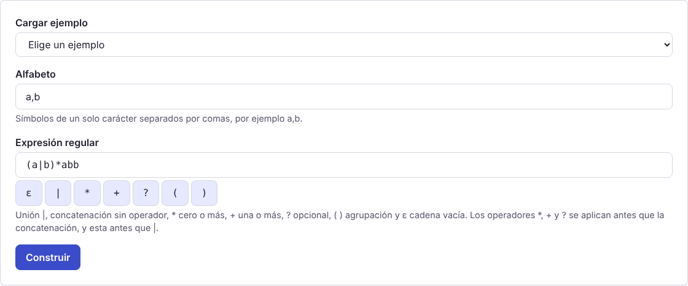
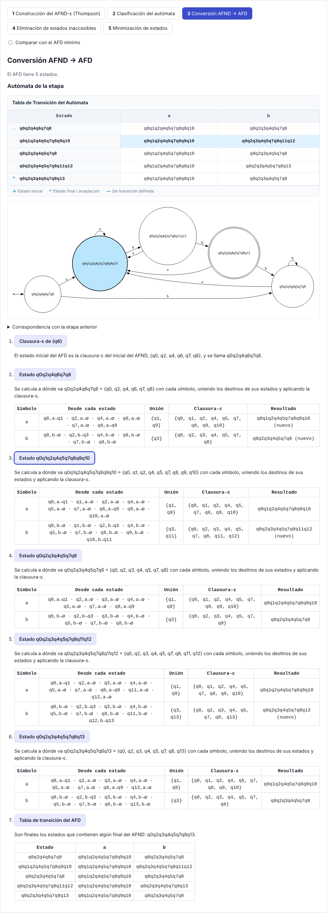
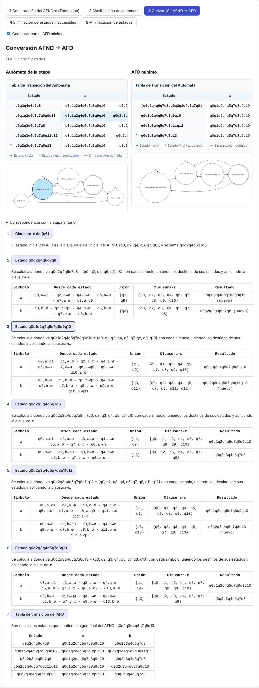
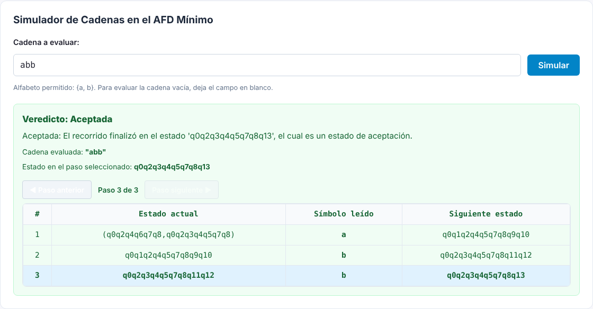

# Manual de usuario — Modalidad A (a partir de un lenguaje)

**Materia:** Teoría de la Computación
**Autor:** David Santiago Rincón Bautista (Desarrollador 1)
**Módulo:** `src/features/language-input`
**Requisitos cubiertos:** RF-01, RF-02, RF-03, RF-06, RF-07, RF-09, RF-10, RF-11, RF-12, RF-13

---

## 1. Qué hace la Modalidad A

La Modalidad A construye el AFD mínimo de un lenguaje regular descrito con un alfabeto y una expresión regular. La aplicación arma primero un AFND-ε con la construcción de Thompson, lo clasifica, lo convierte en AFD, elimina los estados inaccesibles y lo minimiza, y explica cada etapa paso a paso. Al final se pueden simular cadenas sobre el AFD mínimo.

## 2. Cómo usarla

1. Abre la aplicación y elige la pestaña **«Modalidad A: lenguaje»**, que es la que aparece al iniciar.
2. Escribe el **alfabeto**: símbolos de un solo carácter separados por comas, por ejemplo `a,b` o `0,1,2`.
3. Escribe la **expresión regular** con la sintaxis de la sección 3. Los botones bajo el campo insertan `ε` y los operadores donde está el cursor, lo que sirve porque `ε` no está en el teclado.
4. Pulsa **«Construir»**.
5. Revisa las cinco pestañas de etapas y, al final de la página, prueba cadenas en el simulador.

En lugar de los pasos 2 y 3 puedes elegir un ejemplo en **«Cargar ejemplo»**, que llena ambos campos.

## 3. Sintaxis de la expresión regular

| Escribe                  | Significa          | Ejemplo   | Cadenas que describe |
| ------------------------ | ------------------ | --------- | -------------------- |
| dos expresiones seguidas | concatenación      | `ab`      | `ab`                 |
| `\|`                     | unión (una u otra) | `a\|b`    | `a`, `b`             |
| `*`                      | cero o más veces   | `a*`      | ε, `a`, `aa`…        |
| `+`                      | una o más veces    | `a+`      | `a`, `aa`…           |
| `?`                      | cero o una vez     | `a?`      | ε, `a`               |
| `( )`                    | agrupar            | `(ab)*`   | ε, `ab`, `abab`…     |
| `ε`                      | cadena vacía       | `a(b\|ε)` | `a`, `ab`            |

Los operadores `*`, `+` y `?` se aplican primero, después la concatenación y al final la unión: `ab*|c` significa «`a` seguida de cero o más `b`, o bien `c`». Si quieres otro orden, usa paréntesis. Los espacios no importan y la expresión puede tener hasta 200 caracteres.

Algunos lenguajes de clase escritos con esta sintaxis:

| Lenguaje                                                          | Alfabeto | Expresión    |
| ----------------------------------------------------------------- | -------- | ------------ |
| Cadenas que terminan en `abb`                                     | `a,b`    | `(a\|b)*abb` |
| Palabras que inician y terminan en `a`, con `e` o `i` en medio    | `a,e,i`  | `a(e\|i)*a`  |
| Palabras que inician y terminan en `0`, con unos y doses en medio | `0,1,2`  | `0(1\|2)*0`  |

## 4. Cómo leer los resultados

Los resultados aparecen en cinco pestañas numeradas, una por etapa. Cada pestaña muestra un resumen, la tabla de transición (con `→` en el estado inicial, `*` en los finales y `—` donde no hay transición), el diagrama y la lista de pasos.

1. **Construcción del AFND-ε (Thompson):** un paso por cada parte de la expresión, con los estados que crea.
2. **Clasificación del autómata:** dice si el autómata es determinista y por qué; el que sale de Thompson nunca lo es, porque usa transiciones ε.
3. **Conversión AFND → AFD:** un paso por cada estado nuevo, con la misma notación de clase (`AC,1 → A,1→AC · C,1→B`).
4. **Eliminación de estados inaccesibles:** los estados que se alcanzan desde el inicial y los que se eliminan.
5. **Minimización de estados:** la tabla de pares en cada pasada y los estados que se fusionan.

Al pulsar el título de un paso, el diagrama resalta los estados de ese paso. La sección **«Correspondencia con la etapa anterior»** indica de qué estados proviene cada estado nuevo (por ejemplo, «q0q2 proviene de {q0, q2}»). La casilla **«Comparar con el AFD mínimo»** muestra al lado la tabla y el diagrama del resultado final, para comparar cualquier etapa con él.

## 5. Simular cadenas

El simulador, al final de la página, recorre una cadena sobre el AFD mínimo. Escribe la cadena y pulsa **«Simular»**; para probar la cadena vacía, deja el campo en blanco. El veredicto dice si la cadena se acepta o se rechaza y por qué, y la tabla del recorrido muestra cada transición. Con los botones de paso se avanza por el recorrido mientras el diagrama resalta el estado actual.

## 6. Ejemplo completo: `(a|b)*abb`

Con el alfabeto `a,b` y la expresión `(a|b)*abb`, la construcción de Thompson genera un AFND-ε de 14 estados (inicial `q6`, final `q13`). La clasificación lo identifica como no determinista por sus transiciones ε, la conversión produce un AFD de 5 estados, ninguno es inaccesible y la minimización fusiona dos de ellos, de modo que el AFD mínimo tiene 4 estados. El simulador acepta `abb` y `aabb` y rechaza `ab` y la cadena vacía.

## 7. Errores comunes y cómo corregirlos

Cada error aparece debajo del campo que hay que corregir y, si se refiere a un carácter, lo señala resaltado.

| Mensaje                                                           | Cómo corregirlo                                                                               |
| ----------------------------------------------------------------- | --------------------------------------------------------------------------------------------- |
| El alfabeto está vacío.                                           | Escribe al menos un símbolo, por ejemplo `a,b`.                                               |
| El símbolo "a" está repetido en el alfabeto.                      | Deja cada símbolo una sola vez.                                                               |
| "*" es un símbolo reservado y no puede formar parte del alfabeto. | Usa otro carácter; `ε`, `\|`, `*`, `+`, `?`, `(`, `)`, la coma y el espacio están reservados. |
| Cada símbolo debe tener un solo carácter, y "ab" tiene 2.         | Separa los símbolos con comas: `a,b`.                                                         |
| "c" (posición 3) no pertenece al alfabeto {a, b}.                 | Agrega el símbolo al alfabeto o quítalo de la expresión.                                      |
| Falta cerrar el paréntesis abierto en la posición 1.              | Agrega el `)` que falta.                                                                      |
| "*" no tiene una expresión a la que aplicarse.                    | Pon el operador después de un símbolo o de un paréntesis, como en `a*`.                       |
| La expresión tiene 201 caracteres y el máximo es 200.             | Acorta la expresión.                                                                          |
| La conversión generaría más de 200 estados.                       | Simplifica la expresión; algunas, como $(a\|b)^*a(a\|b)^7$, generan demasiados subconjuntos.  |
